# LanDrop

LanDrop is a lightweight LAN file-transfer app for Windows and Android. It is built for direct local transfers without SMB shares, cloud accounts, internet servers, or Windows shared-folder setup.

The current app uses a Rust/Tauri desktop backend for Windows, a Svelte desktop UI, and a native Kotlin + Material 3 Android client. Files and folders are streamed directly from disk with manifests, so folders are not zipped or duplicated before sending.

## Features

- Automatic LAN discovery over UDP broadcast, with manual IP fallback.
- Ethernet-first adapter selection on Windows, with Wi-Fi and direct-cable support.
- File, multi-file, and folder sending without ZIP staging.
- Parallel file workers for many small files.
- Transfer progress, speed display, pause/resume, cancel, and history.
- Pair-code receive protection and Quick Save modes.
- Trusted-device management.
- Android Material 3 UI with persistent save folders and categorized receive folders.
- QR-based Wi-Fi Direct connections with an always-available stop control.
- Secure remote invites for direct port-forwarded transfers or private overlay networks (such as Tailscale, Headscale, or WireGuard).

## Screenshots

Click any screenshot to view it at full size.

### Windows

| Receive | Send |
| --- | --- |
| [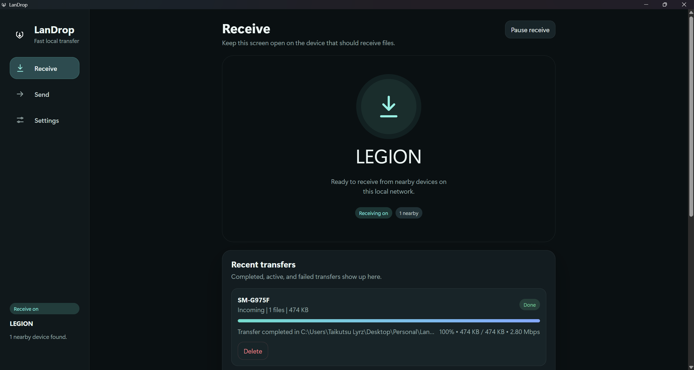](docs/screenshots/windows/receive.png) | [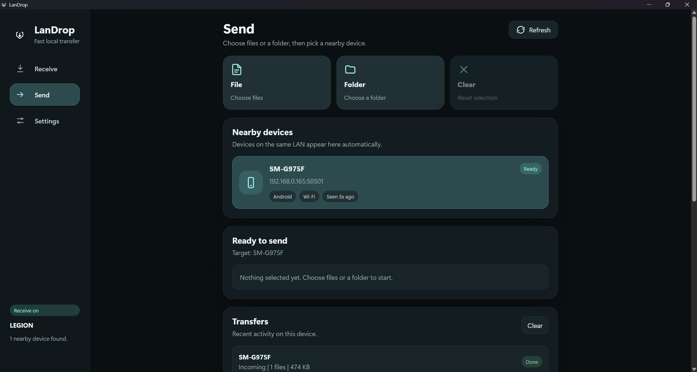](docs/screenshots/windows/send.png) |

| Transfer history | Incoming transfer |
| --- | --- |
| [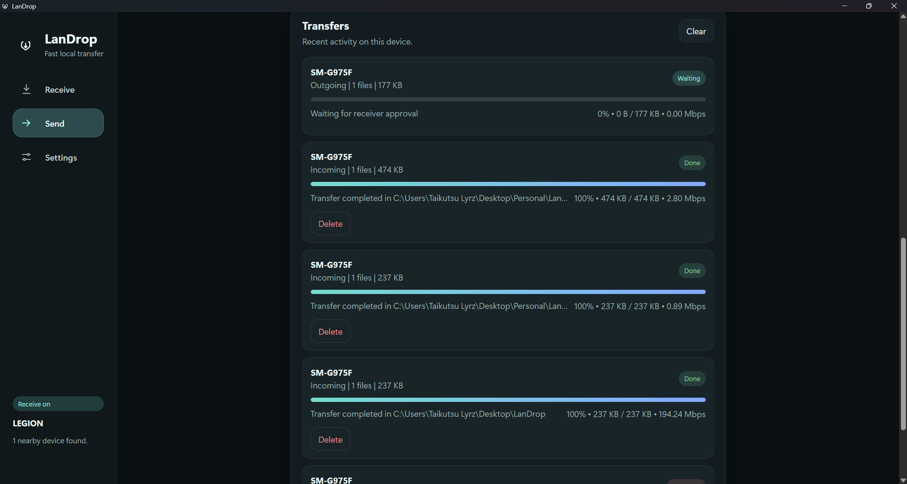](docs/screenshots/windows/transfer-history.png) | [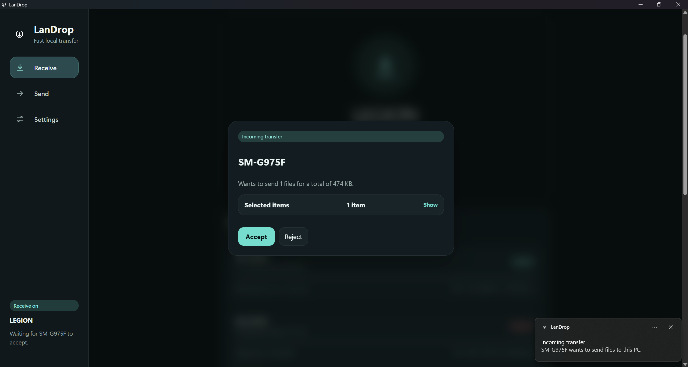](docs/screenshots/windows/incoming-transfer.png) |

<details>
<summary>Wi-Fi Direct connection</summary>

[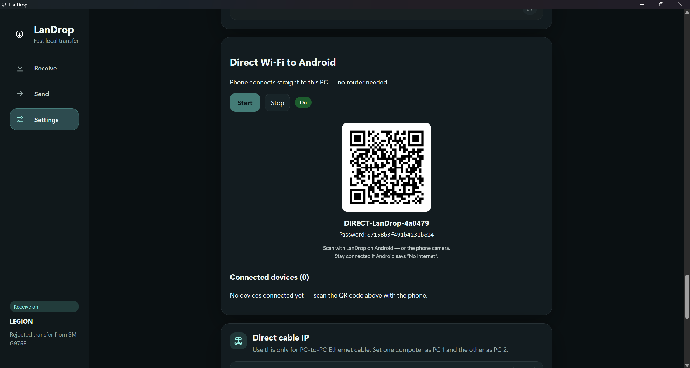](docs/screenshots/windows/wifi-direct.png)

</details>

### Android

| Receive | Send | Ready to send |
| --- | --- | --- |
| [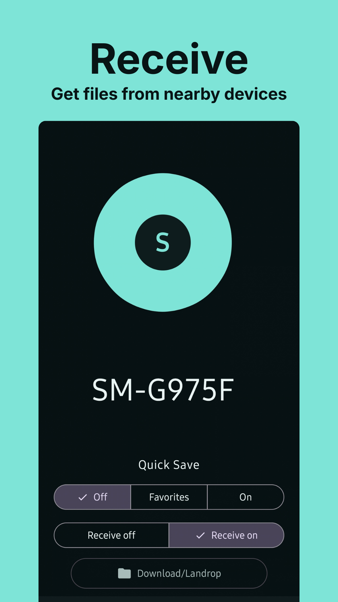](docs/screenshots/android/receive.png) | [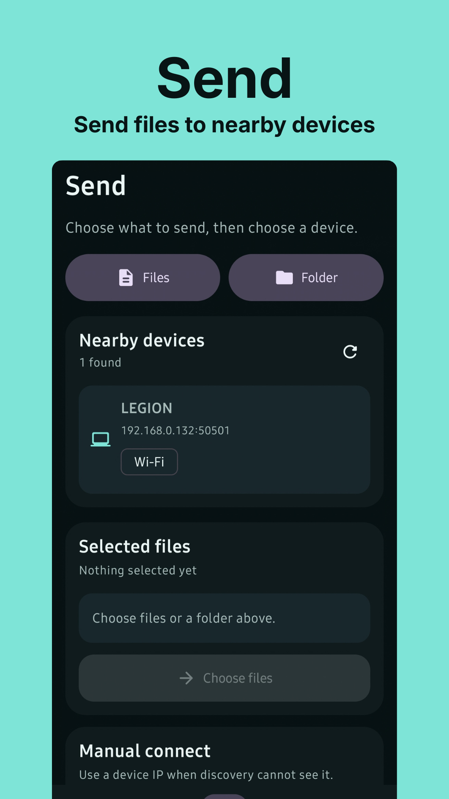](docs/screenshots/android/send.png) | [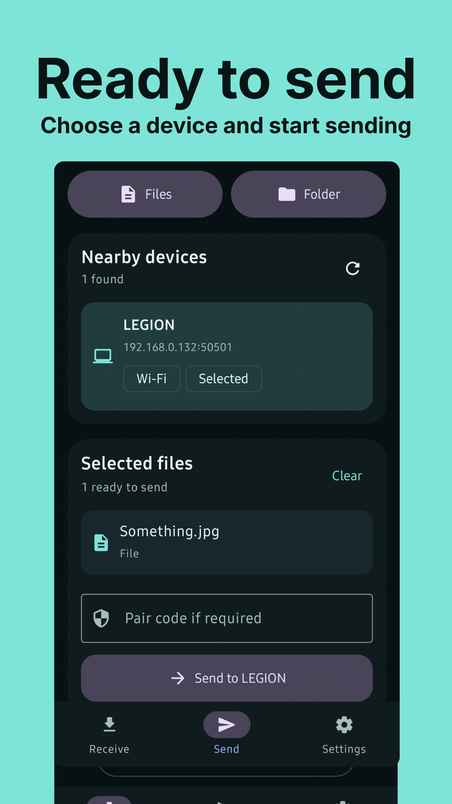](docs/screenshots/android/ready-to-send.png) |

| Incoming transfer | Transfer progress | Wi-Fi Direct |
| --- | --- | --- |
| [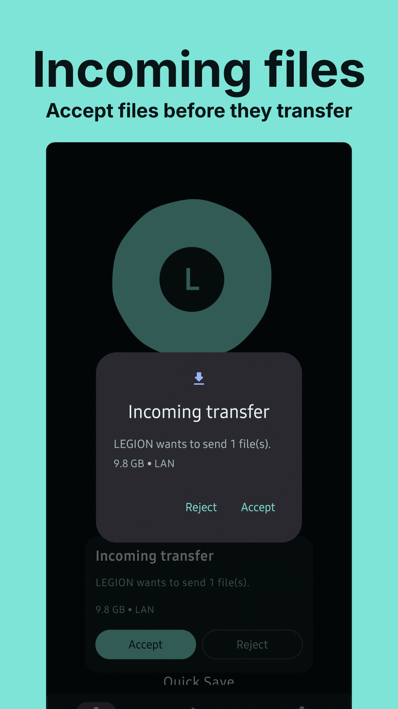](docs/screenshots/android/incoming-transfer.png) | [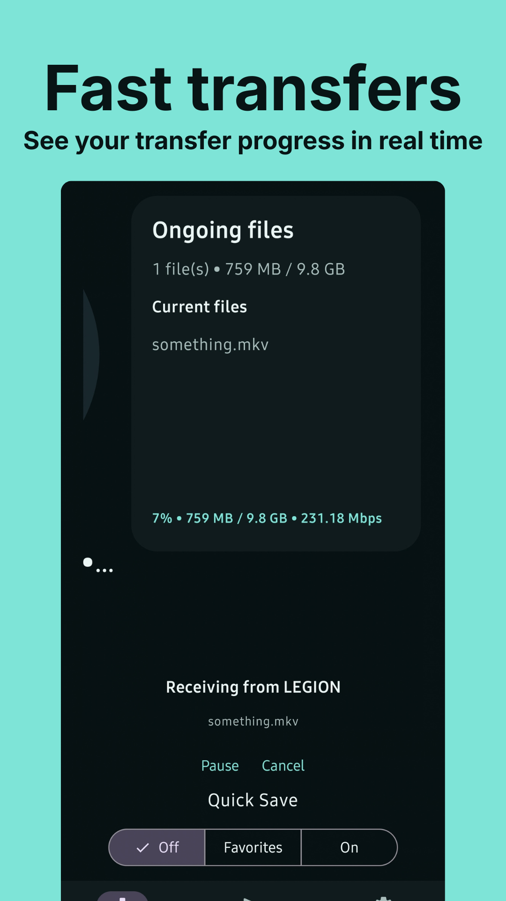](docs/screenshots/android/transfer-progress.png) | [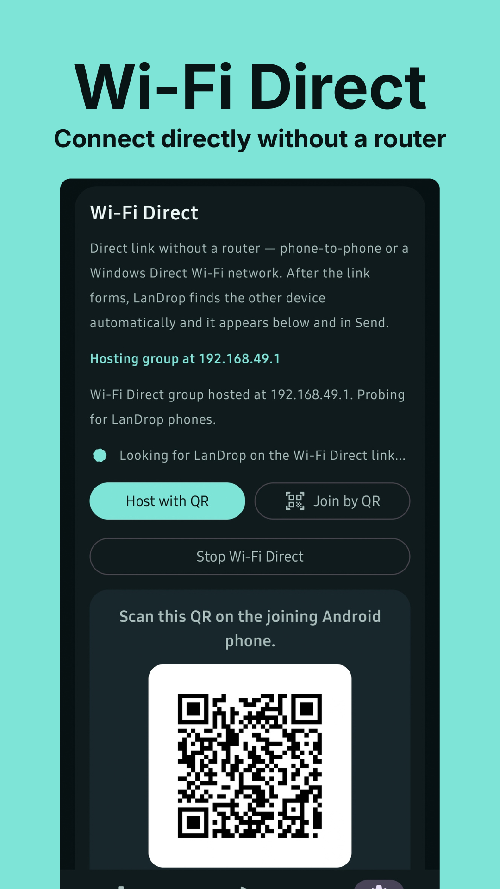](docs/screenshots/android/wifi-direct.png) |

## Repository Layout

- `src/` - Svelte desktop UI.
- `src-tauri/` - Rust desktop backend, discovery, transfer engine, Windows integration, and remote access prototype.
- `android/` - native Android client using Kotlin and Jetpack Compose Material 3.
- `docs/` - protocol and roadmap documentation.
- `tools/` - Windows validation and dataset helper scripts.
- `validation/` - repeatable two-device validation notes and manifests.

## Development Setup

Install Node.js, Rust stable MSVC, Android SDK/NDK for Android builds, and the Windows WebView2 runtime.

```powershell
npm.cmd install
npm.cmd run check
& "$env:USERPROFILE\.cargo\bin\cargo.exe" check --manifest-path .\src-tauri\Cargo.toml
```

Run the Windows desktop app:

```powershell
npm.cmd run tauri:dev
```

Build the Windows desktop installer:

```powershell
npm.cmd run tauri:build
```

Build the Android debug APK:

```powershell
cd android
.\gradlew.bat assembleDebug
cd ..
```

Install the Android debug APK through ADB:

```powershell
& "$env:LOCALAPPDATA\Android\Sdk\platform-tools\adb.exe" install -r .\android\app\build\outputs\apk\debug\app-debug.apk
```

## Network Notes

LanDrop is designed for local networks first. Windows filters out loopback and VPN-like interfaces for discovery, prefers Ethernet when available, and supports direct-cable IPv4 setup from the settings screen.

For best performance, use wired gigabit Ethernet, confirm both adapters negotiate at 1 Gbps or better, and keep both devices awake during large transfers.

## Remote Sharing

Remote sharing is experimental and always uses the dedicated secure remote port (`50502` by default), never the normal LAN transfer port (`50501`). It pins the receiving PC certificate and requires the secret included in the invite.

- **Direct internet** uses UPnP when available, or a manual TCP port forward. It cannot bypass double NAT or CGNAT.
- **VPN / overlay** needs no router port forwarding. Install and connect the same private overlay on the PC and phone (for example Tailscale, a self-hosted Headscale network, or WireGuard), enter the PC's overlay address/hostname in LanDrop, and create a VPN invite. The overlay remains an external dependency; LanDrop does not install or configure it.

## Security Notes

The local LAN path supports manual acceptance, optional pair code, and trusted-device Quick Save. Remote access should only expose the dedicated secure remote port, not the normal LAN transfer port.

## Validation

Use the validation helpers when testing on two real devices:

```powershell
powershell -NoProfile -ExecutionPolicy Bypass -File .\tools\Generate-LanDropTestDataset.ps1 -Profile smoke -OutputPath .\validation\datasets\smoke -Force
powershell -NoProfile -ExecutionPolicy Bypass -File .\tools\Export-LanDropManifest.ps1 -RootPath .\validation\datasets\smoke -OutputPath .\validation\manifests\source-smoke.json
powershell -NoProfile -ExecutionPolicy Bypass -File .\tools\Compare-LanDropManifest.ps1 -ReferenceManifest .\validation\manifests\source-smoke.json -CandidateManifest .\validation\manifests\receiver-smoke.json
```

See `validation/README.md` for the full two-PC soak and interruption test matrix.
