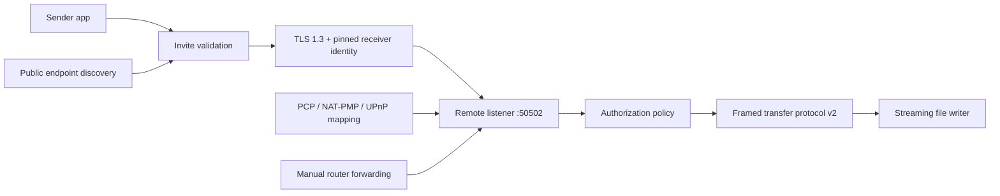

# LanDrop Remote Transfer v2

## Purpose

Remote Transfer lets a user leave a receiving computer online and send files to it from another network. It extends LanDrop beyond local discovery without weakening the fast, account-free LAN path.

This feature must not expose the existing plaintext LAN listener directly to the internet. The remote path uses a separate encrypted listener, explicit opt-in, pinned device identity, short-lived invitations, and revocable trust.

## Product Contract

- LAN transfers remain local, automatic, and independent of internet access.
- Remote access is disabled by default.
- Enabling remote access never changes LAN discovery or LAN transfer behavior.
- The receiver must be powered on, awake, running LanDrop, and reachable.
- Direct remote transfer contains no cloud file storage.
- A small rendezvous service may be added later for endpoint discovery and relaying, but it must never receive plaintext file contents.
- The UI must clearly distinguish direct reachability, relay reachability, and unavailable networks.

## Why Raw Port Forwarding Is Not Acceptable

The current TCP listener on port `50501` accepts LAN protocol frames without TLS. Publishing that socket through a router would expose:

- device identity and transfer metadata in plaintext;
- the offer parser and transfer engine to the public internet;
- pair-code attempts to online guessing;
- a long-lived attack surface with no certificate identity;
- no reliable way for a sender to prove it reached the intended computer.

Remote Transfer therefore uses a separate port, initially `50502`, and TLS 1.3. The LAN port must not be automatically mapped by the app.

## Architecture



### Separate Transport, Shared Transfer Engine

The remote listener terminates TLS, authenticates the invitation, applies rate limits, and then passes an authenticated byte stream to the same framed protocol used on LAN.

The protocol framing functions must depend on `AsyncRead` and `AsyncWrite`, not directly on `TcpStream`. File streaming should follow the same rule as TLS integration progresses.

## Device Identity

Each installation owns a persistent Ed25519 identity key:

- generated locally on first run;
- private key stored with Windows DPAPI protection on Windows;
- private key stored in Android Keystore on Android;
- public key used as the stable device identity;
- device ID derived from a hash of the public key;
- keys never leave the device.

The TLS certificate may be self-signed because trust is established by pinning the identity public key or certificate fingerprint from an invitation. System public CAs are not required.

Reinstalling or resetting identity creates a new device and invalidates old invitations and trust records.

## Remote Invitation

A remote invitation is a compact, versioned document represented as a QR code, shareable link, or text code:

```json
{
  "version": 1,
  "deviceId": "sha256:...",
  "deviceName": "Home PC",
  "endpoints": [
    {
      "host": "203.0.113.20",
      "port": 50502,
      "transport": "tcp_tls"
    }
  ],
  "identityFingerprint": "sha256:...",
  "token": "256-bit-random-value",
  "expiresAtMs": 1760000000000
}
```

Rules:

- Tokens use at least 256 bits of cryptographically secure randomness.
- Invitations expire, defaulting to 15 minutes.
- A token is single-use unless the user explicitly creates a persistent trusted-device invitation.
- The receiver stores only a keyed hash of an invitation token.
- The sender pins the receiver identity before sending any file metadata.
- Device name is display-only and never used for authentication.

## Authorization

Remote access has stricter defaults than LAN access:

1. TLS identity pin succeeds.
2. Invitation token is valid, unexpired, and unused.
3. Receiver policy allows the sender.
4. User accepts the transfer unless the sender is trusted and Remote Quick Save is enabled.
5. Pair codes remain optional for LAN and are not a substitute for remote invitation entropy.

Remote Quick Save must be a separate setting from LAN Quick Save.

## Reachability

### Automatic Mapping Order

Try mappings in this order:

1. PCP, standardized by RFC 6887.
2. NAT-PMP where supported.
3. UPnP Internet Gateway Device as a compatibility fallback.
4. Manual router forwarding instructions.

Every mapping has a finite lease and is renewed while Remote Transfer remains enabled. Disable, shutdown, or sign-out attempts to remove the mapping.

Only TCP port `50502` is mapped. UDP discovery port `50500` and LAN TCP port `50501` are never mapped.

### Public Endpoint Discovery

STUN may be used to determine the public endpoint and NAT behavior. STUN exchanges network metadata only; it does not carry file data.

The app must show:

- `Direct remote ready`: mapping and external verification succeeded.
- `Manual forwarding required`: automatic mapping unavailable.
- `Relay required`: CGNAT, symmetric NAT, or inbound filtering prevents direct access.
- `Offline`: no usable internet route.
- `Disabled`: remote listener and mappings are stopped.

### CGNAT

PCP, NAT-PMP, and UPnP cannot generally bypass carrier-grade NAT controlled by an ISP. Supporting those users requires one of:

- an IPv6 direct path with firewall pinhole management;
- a user-managed VPN such as WireGuard;
- a LanDrop rendezvous and encrypted relay service.

The UI must not claim that port forwarding succeeded until the endpoint has been tested from outside the local network.

## TLS Requirements

- TLS 1.3 preferred; TLS 1.2 may be disabled for the remote listener.
- Receiver certificate or identity key is pinned from the invitation.
- No certificate-warning bypass.
- Application protocol negotiated as `landrop/2`.
- Handshake timeout: 10 seconds.
- Idle pre-auth timeout: 10 seconds.
- Authenticated idle timeout: configurable, default 120 seconds.
- Maximum concurrent unauthenticated sessions: 8.
- Per-IP connection and token-attempt rate limits.
- Sensitive values are omitted from diagnostics and logs.

## Transfer Protocol

Remote Transfer requires `framed_v2`; `raw_v1` is rejected remotely.

Required protocol behavior:

- chunk boundaries remain bounded;
- peer-notified pause, resume, and cancel;
- receiver acknowledgements;
- persisted resume offsets;
- manifest and path validation;
- no ZIP staging;
- optional whole-file hash verification;
- multiple file workers limited by receiver policy.

The first remote release should cap parallel workers conservatively because WAN latency and packet loss differ from LAN conditions.

## Path and Storage Safety

All existing receiver protections remain mandatory:

- reject absolute paths;
- reject `..` traversal;
- reject Windows reserved device names;
- write to `.landrop-part`;
- never overwrite without the configured conflict policy;
- reserve disk space before acceptance where possible;
- verify final byte count before rename;
- classify completed files into the configured LanDrop folders.

## Windows Behavior

- Remote access is opt-in and may require an administrator-approved firewall rule.
- The firewall rule is scoped to the remote TCP port only.
- The listener runs only while the user setting is enabled.
- Prevent sleep during an active accepted transfer, but do not keep the PC awake merely because remote access is enabled unless the user selects that option.
- Show startup impact and provide a `Start LanDrop with Windows` option.
- Surface router mapping status and external verification separately.

## Android Behavior

Android is initially a remote sender and later may be a remote receiver.

Receiver limitations:

- background execution requires a foreground service;
- Wi-Fi sleep and battery optimization can terminate long listeners;
- inbound carrier networks commonly use CGNAT;
- router mapping is relevant primarily when Android is on home Wi-Fi.

Remote receiving on Android must not ship until foreground-service notifications, wake locks during active transfers, and Android Keystore identity storage are complete.

## Threat Model

Defend against:

- internet-wide port scans;
- replayed invitations;
- guessed pair codes;
- malicious or malformed manifests;
- path traversal and reserved filenames;
- oversized control frames;
- connection and disk exhaustion;
- stale router mappings;
- endpoint substitution and man-in-the-middle attacks;
- leaked logs or diagnostics.

Not fully defended in the direct-only phase:

- denial of service against the public endpoint;
- compromised endpoint devices;
- traffic analysis;
- networks that block all inbound connectivity.

## Implementation Phases

### R1: Transport Foundation

- Generalize protocol framing to `AsyncRead` / `AsyncWrite`.
- Add persistent installation identity abstraction.
- Add remote settings and status types.
- Add redaction tests for diagnostics.
- Keep all remote listeners disabled.

Exit: no LAN behavior changes and all existing transfer tests pass.

### R2: Encrypted Manual Remote Path

- Add `rustls` and `tokio-rustls`.
- Add a TLS 1.3 listener on a separate port.
- Add invitation generation and import.
- Pin receiver identity on the sender.
- Require framed protocol v2.
- Add manual public host and port support.

Exit: Windows sender to Windows receiver works through a manually configured router forward.

### R3: Router Mapping

- Add PCP mapping.
- Add NAT-PMP fallback.
- Add UPnP IGD fallback.
- Renew and remove leases.
- Verify the endpoint externally.
- Explain manual forwarding without exposing the LAN port.

Exit: supported home routers can enable and disable mappings without manual administration.

### R4: Android Sender

- Import invitation by QR or text.
- Store pinned identities securely.
- Send over TLS and framed v2.
- Support pause, cancel, retry, and crash resume.

Exit: Android can send remotely to an online Windows PC.

### R5: Trusted Remote Devices

- Persistent invitations.
- Per-device revoke and rename.
- Remote Quick Save policy.
- Device-specific limits and audit history.
- Key rotation and identity reset flow.

### R6: Hardening

- WAN fault injection and long soak tests.
- Rate-limit and malformed-input tests.
- Sleep, wake, reboot, router-renewal, and IP-change tests.
- Signed installer and firewall onboarding.
- Security review before enabling the feature by default in release builds.

### R7: Relay Option

- Optional rendezvous service.
- End-to-end encrypted relay with pinned endpoint identities.
- File bytes remain opaque to the relay.
- Quotas and abuse controls.

Relay is required for broad CGNAT support but is not required for direct port-forwarded v2.

## Test Matrix

- Windows to Windows, manual IPv4 forward.
- Android to Windows, manual IPv4 forward.
- IPv6 direct connection.
- PCP, NAT-PMP, and UPnP routers.
- Double NAT and CGNAT.
- Public IP change during idle and active sessions.
- Router reboot and lease renewal.
- Wrong fingerprint, expired token, reused token, and revoked device.
- 100 GB file and 10,000 small files.
- Pause/resume from either peer.
- Sender and receiver crash/restart.
- Packet loss, latency, bandwidth reduction, and disconnect.
- Disk full and filename conflicts.

## Release Gate

Remote Transfer must not be labelled production-ready until:

- TLS identity pinning is mandatory;
- the plaintext LAN listener cannot be mapped by app code;
- invitation replay is blocked;
- diagnostics redact secrets;
- direct endpoint verification is implemented;
- Windows and Android interoperability passes the WAN test matrix;
- the user can disable access and revoke every trusted remote device.

## Current Implemented Slice

The current desktop implementation includes:

- a separate TLS listener on TCP `50502`;
- a DPAPI-protected self-signed receiver certificate and 256-bit access token;
- certificate pinning from the imported invite;
- a local tunnel so the existing framed multi-file engine can be reused;
- framed-v2 enforcement for internet-facing transfer offers;
- eight-session unauthenticated connection cap;
- automatic UPnP mapping with a one-hour lease and renewal;
- public IP retrieval from the UPnP gateway with STUN fallback;
- compact binary invitations that remain backward-compatible with the original JSON links;
- manual public IP or DNS fallback;
- mapping removal when Remote access is disabled;
- invite revocation by resetting the remote identity;
- Windows firewall rule support for the secure remote port.

The current Android implementation includes:

- remote invitation import from the Settings screen;
- offline QR invitation scanning with immediate validation and connection;
- exact receiver-certificate pinning before metadata is sent;
- TLS 1.3 with the `landrop/2` application protocol where supported by Android;
- an app-local TCP tunnel that keeps the existing framed-v2 sender and parallel workers inside TLS;
- encrypted invitation persistence using an Android Keystore AES-GCM key;
- automatic reconnection to the saved remote computer on app startup;
- explicit use and forget controls without logging invitation secrets.

The Windows invitation screen renders the same invitation as a high-resolution QR code and
plain text. Firewall setup replaces only LanDrop's named rules, and the Settings screen can
remove all LanDrop-created rules through the same elevated Windows flow.

Android is a remote sender in this slice. It is not an internet-facing remote receiver.

This is a direct-path beta, not the full release gate. PCP, NAT-PMP, external endpoint verification, short-lived/single-use invitation tokens, per-IP rate limiting, Android remote receiving, WAN soak testing, and relay support remain future slices.
